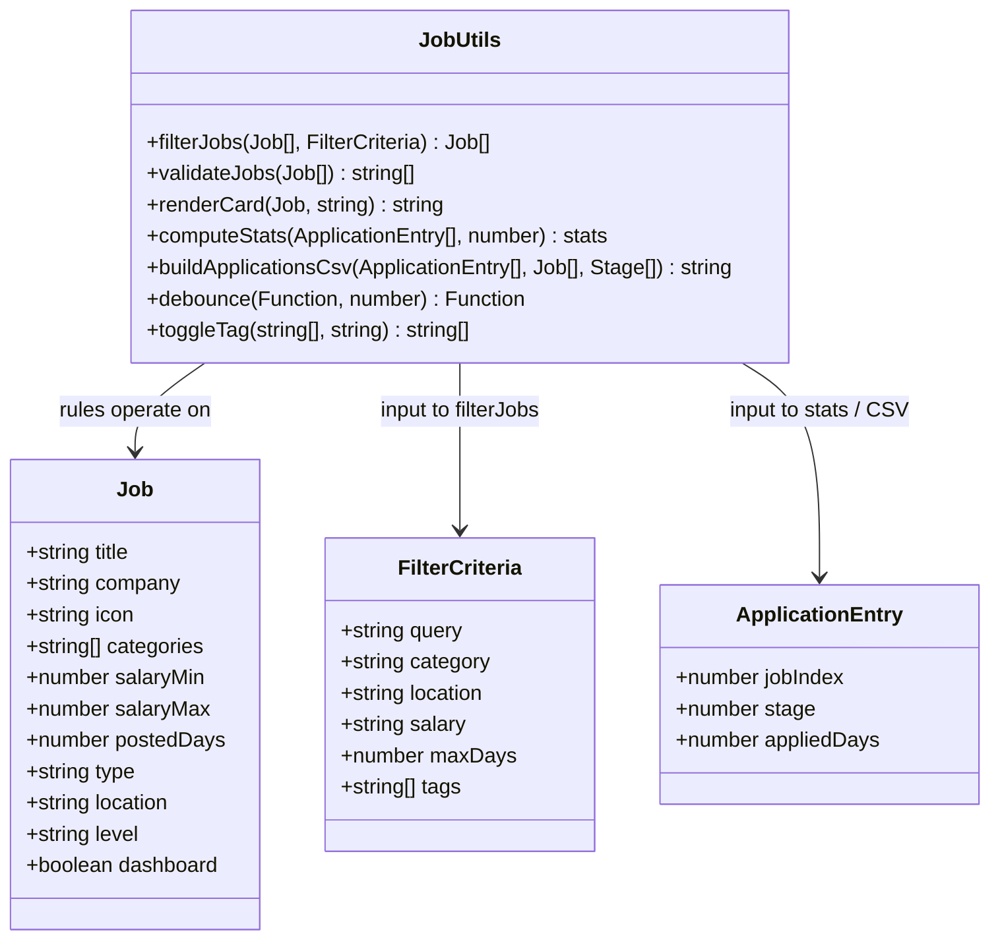
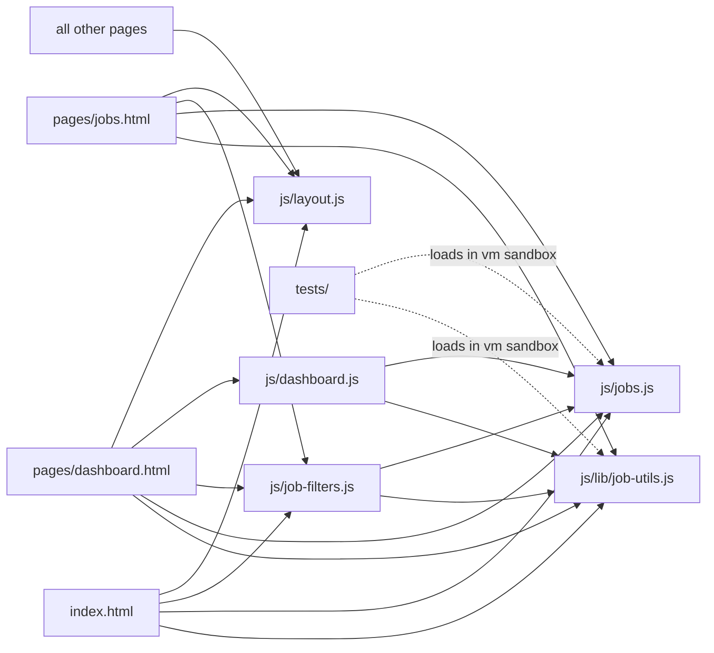
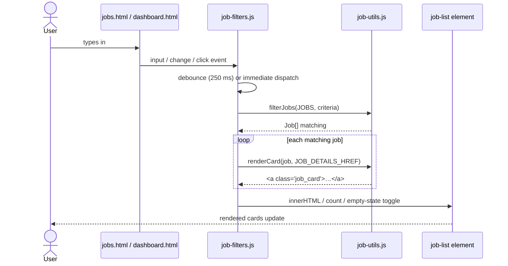

# Job Portal

[](LICENSE)
[](SECURITY.md)
[](https://opensource.org/licenses/MIT)
[](#)
[](#)
[](tests/)
[](jsconfig.json)
[](https://github.com/ogc16/simple_job_bank/actions/workflows/ci.yml)
[](https://github.com/ogc16/simple_job_bank/actions/workflows/codeql.yml)
[](https://securityscorecards.dev/viewer/?uri=github.com/ogc16/simple_job_bank)
[](.github/dependabot.yml)
[](CONTRIBUTING.md)

A lightweight, static job search portal with a live filtering dashboard. Pure HTML, CSS, and vanilla JavaScript — no build step, no framework, no dependencies beyond Font Awesome.

## Pages

| Page | Purpose |
| --- | --- |
| `index.html` | Landing page with featured jobs (stays at repo root for GitHub Pages) |
| `pages/dashboard.html` | Control center: summary stats, notifications, application pipeline, recommendations + filters |
| `pages/jobs.html` | Full job list with the same filtering as the dashboard |
| `pages/job-details.html` | Individual job detail view |
| `pages/analytics.html` | Portal statistics |
| `pages/documents.html` | User documents / CV |
| `pages/settings.html` | Account settings |
| `pages/help.html` | Support / FAQ |
| `pages/about.html` | About page: mission, value props, stats, testimonials, contact, closing CTA |
| `pages/login.html` | Sign-in form |
| `pages/signup.html` | Account creation form |
| `pages/forgot-password.html` | Password recovery form |

## Running locally

No server or install needed — open any page directly:

```
start pages/dashboard.html
```

Or serve the folder for a more faithful experience (works with any static server):

```
npx serve .
```

## Structure

```
.
├── index.html              # Landing page (root)
├── pages/                  # All other HTML pages
│   ├── dashboard.html      # Filterable job board
│   ├── jobs.html           # Full job list
│   ├── job-details.html    # Job detail view
│   ├── analytics.html      # Statistics
│   ├── documents.html      # User documents
│   ├── settings.html       # Account settings
│   ├── help.html           # Support
│   ├── about.html          # About page
│   ├── login.html          # Sign-in
│   ├── signup.html         # Sign-up
│   └── forgot-password.html# Password recovery
├── css/                    # Stylesheets
│   ├── style.css           # Portal styles (design tokens, badges, skeleton, responsive)
│   └── login.css           # Auth page styles
├── js/                     # Scripts
│   ├── lib/job-utils.js    # Pure rules + JSDoc types: formatting, filters, validation, CSV
│   ├── jobs.js             # Job data (single source of truth for all listings)
│   ├── job-filters.js      # Renderer, debounced search, skeleton, empty state, badges
│   ├── dashboard.js        # Dashboard: greeting, stats, notifications, pipeline, CSV export
│   └── layout.js           # Shared sidebar navigation (single source of truth)
├── tests/                  # Zero-dependency test suite (Node's built-in runner)
│   ├── job-utils.test.js   # Unit tests for the pure rules
│   ├── jobs-data.test.js   # Data-integrity tests for the job listings
│   ├── job-filters.dom.test.js  # End-to-end filter tests against a DOM stub
│   ├── dashboard.dom.test.js    # End-to-end dashboard tests against a DOM stub
│   ├── check-coverage.js   # Coverage gate enforced by CI (fails under thresholds)
│   └── helpers/            # vm sandbox + DOM stub shared by all tests
├── docs/
│   └── architecture.md     # UML diagrams (Mermaid: class, component, sequence, state)
├── .github/                # CI, CodeQL SAST, scorecard, dependabot, issue/PR templates
├── 404.html                # Friendly not-found page
├── robots.txt              # Crawler rules + sitemap pointer
├── sitemap.xml             # XML sitemap for search engines
├── jsconfig.json           # JSDoc type-checking config (checkJs + tsc --noEmit)
├── eslint.config.js        # ESLint flat config (zero-dependency)
├── .editorconfig           # Editor/IDE formatting defaults
├── .gitattributes          # Line-ending & diff normalization
├── CHANGELOG.md            # Keep a Changelog / SemVer history
├── SECURITY.md             # Security policy & disclosure
├── CONTRIBUTING.md         # Contribution guide
├── CODE_OF_CONDUCT.md      # Contributor Covenant 2.1
├── LICENSE                 # MIT license
└── pic/logo.jpg            # Favicon / brand logo
```

## Architecture

UML diagrams (Mermaid — rendered automatically on GitHub). The full set,
including state and activity diagrams, lives in [docs/architecture.md](docs/architecture.md).

### Class diagram — data model



### Component diagram — pages, scripts, data flow



### Sequence diagram — filtering a job list



## Development

No install is required for anything.

**Run the tests.** They load the real browser scripts in a `vm` sandbox — plus a
DOM stub for the UI scripts — and use Node's built-in test runner:

```
node --test
```

**Enforce the coverage gate.** CI runs the same suite under the built-in
coverage reporter and fails any pull request whose aggregate coverage drops
below the thresholds in `tests/check-coverage.js` (line ≥ 90%, branch ≥ 75%,
funcs ≥ 90%):

```
node tests/check-coverage.js
```

**Type-check.** The code is typed with JSDoc and verified with the TypeScript
compiler (`tsc -p jsconfig.json`). TypeScript itself is fetched on demand via
`npx` and never becomes a project dependency:

```
npx --yes -p typescript tsc -p jsconfig.json
```

**Lint.** ESLint (flat config, core rules only, no packages added):

```
npx --yes eslint@9 js tests
```

Every pull request must pass all four (tests, coverage gate, type check, lint).
**CI** runs them on GitHub Actions (git push to `main`, pull requests),
**CodeQL** performs semantic SAST on the same flow, **Dependabot** keeps the
workflow actions updated, and [OpenSSF Scorecard](https://www.securityscorecards.dev/)
monitors supply-chain security weekly and publishes results to the Security tab.
Releases are attested with SLSA build provenance via `attest-build-provenance`.

**Architecture diagrams.** The key UML diagrams (class / component / sequence)
are rendered above; [docs/architecture.md](docs/architecture.md) adds the state
and activity diagrams.

For contribution guidance, see [CONTRIBUTING.md](CONTRIBUTING.md); for security
matters, [SECURITY.md](SECURITY.md). Releases are tracked in [CHANGELOG.md](CHANGELOG.md).

## How the shared pieces work

- **`js/lib/job-utils.js`** — the pure, tested core. Formatting (`salaryText`, `dateText`, badges), filtering (`filterJobs`), data validation (`validateJobs`), and dashboard computations (stats, CSV). Loaded on every page that uses job logic; also what the unit tests exercise.
- **`js/jobs.js`** — the single source of truth for all job listings. Each entry carries the title, company, icon class, salary range, posting age, category tags, and structured fields for location, type, and seniority level — all rendered automatically and validated by `tests/jobs-data.test.js`.
- **`js/job-filters.js`** — renders cards from `js/jobs.js` via `job-utils.js` and powers search (debounced 250 ms), category, location, salary-range, recency selects, and tag chips on `pages/dashboard.html` / `pages/jobs.html`. All filter controls are optional — a page shows only the controls it defines. On `index.html` it renders the top 3 most recent jobs as featured cards. A skeleton shimmer is shown briefly during initial render, and an empty state appears when no jobs match the current filters.
- **`js/dashboard.js`** — the dashboard control center. Greets the user by name (read from `localStorage.portal.user`, set when logging in or signing up), computes summary stats (applied / interviews / saved / offers) via `job-utils.js`, renders the application pipeline with a 4-step progress bar (Applied → Shortlisted → Interview → Offer), lists notifications with read-state badges, and exports application history as a CSV download.
- **`js/layout.js`** — injects the sidebar into every portal page (pages contain only `<nav id="app-nav"></nav>`). It detects the current page from the URL and marks the matching link as active, so adding or renaming a page is a one-line change.
- **`css/style.css`** — colors are defined once as CSS variables in `:root` (e.g. `--accent`, `--bg`), so rebranding is a single edit. Includes card hover/active/focus-visible states, colored badge pills for location/type/level, skeleton shimmer animation, and responsive breakpoints at 1024px, 768px, and 480px.

## Adding a job

Open `js/jobs.js` and append an object to the `JOBS` array:

```js
{
  title: 'Staff Engineer',
  company: 'Stripe',
  icon: 'fab fa-stripe',          // any Font Awesome brand class
  categories: ['programming'],
  salaryMin: 180,                  // annual, USD (whole thousands)
  salaryMax: 250,
  postedDays: 1,
  type: 'Full-time',              // or 'Contract'
  location: 'Remote',             // or 'Hybrid' / 'On-site'
  level: 'Senior',                // or 'Junior' / 'Mid' / 'Manager'
  dashboard: true                 // true = shown on dashboard recent list
}
```

The renderer in `js/job-filters.js` handles all markup, badges, and count automatically.

## Customizing the brand

- **Logo / favicon:** replace `pic/logo.jpg`, referenced by every page's `<link rel="icon">`.
- **Colors:** edit the `:root` variables at the top of `css/style.css` (and `css/login.css` for auth pages).
- **Nav links:** edit the `NAV_LINKS` array in `js/layout.js`.

## Accessibility

- Keyboard-visible `:focus-visible` rings on interactive elements.
- All inputs have associated `<label>` elements; selects carry `aria-label`.
- Filter tag chips are operable by mouse and keyboard (Enter / Space) and expose `aria-pressed` + `aria-controls`.
- Each rendered card has a descriptive `aria-label` for screen readers.
- The application pipeline uses `role="progressbar"` with numeric `aria-valuenow` for stage progress.
- `aria-hidden="true"` on all decorative Font Awesome icons.
- `aria-live="polite"` + `aria-busy` on the job list for announced count changes.
- Empty state appears when no jobs match, with a clear-filters button.

## Browser support

Modern evergreen browsers (Chrome, Edge, Firefox, Safari). No legacy support.