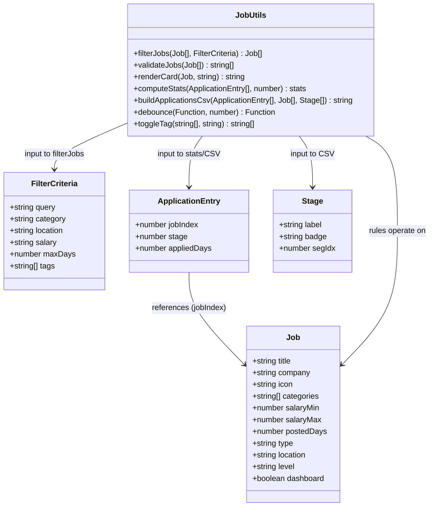
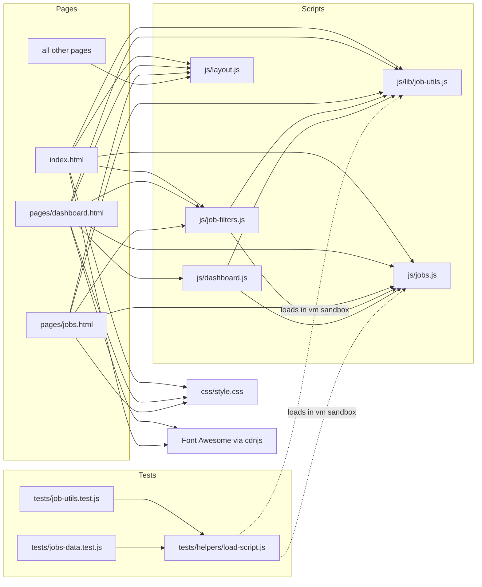
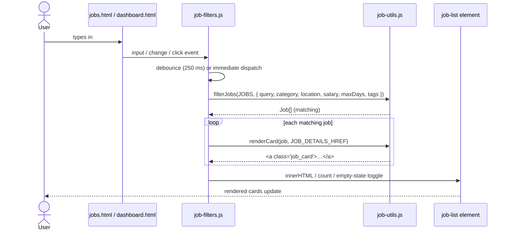
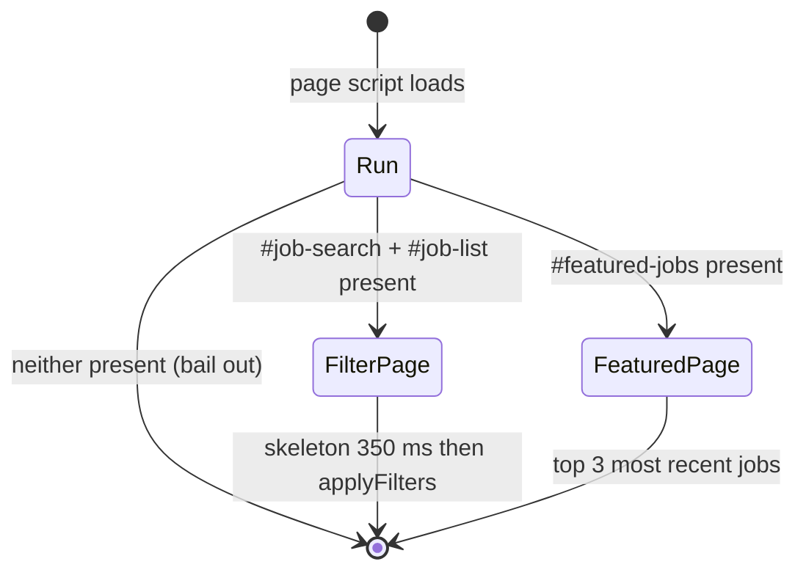
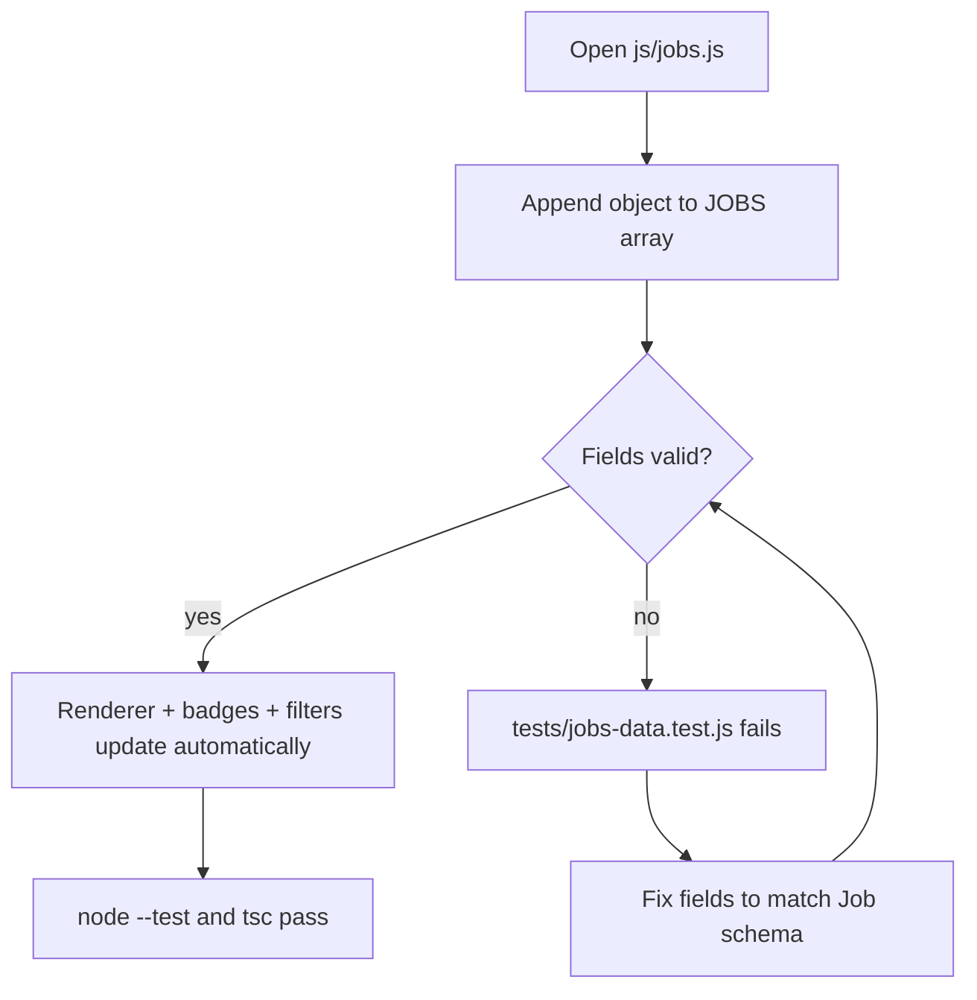

# Architecture & UML

The portal is a set of static HTML pages sharing a hand-written JavaScript
"design system" of pure rules and thin DOM wiring. These diagrams are authored
in [Mermaid](https://mermaid.js.org) and render on GitHub automatically.

## Class diagram — data model

## Component diagram — pages, scripts, and data flow

## Sequence diagram — filtering a job list

## State diagram — renderer bootstrap modes

## Activity diagram — adding a job

